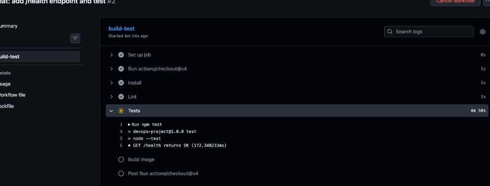
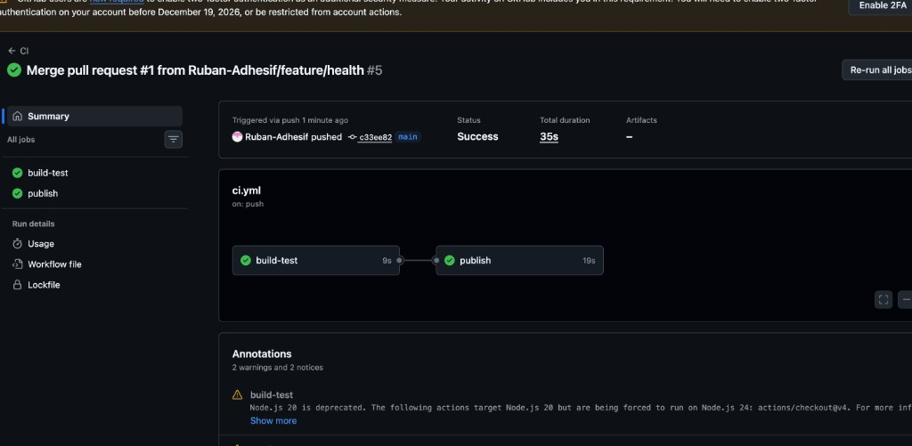

# devops-project

Petite API Node pour le lab DevOps.

Auteurs :
- Ruben Bensais Rueda
- Kais Luce Laurent
- Sami Semallai

`GET /health` répond `OK`.

## Lancer en local

```bash
npm install
npm start
```

Puis ouvrir http://localhost:3000/health

## Tests

```bash
npm test
npm run lint
```

## Docker

```bash
docker build -t myapp:0.1 .
docker run -d -p 3000:3000 --name myapp myapp:0.1
curl http://localhost:3000/health
```

L'image du lab est publiée sur GitHub Container Registry au merge sur `main`.

## Pipelines

Le test cassé, `GET /health` attendait `KO` :



Le run sur `main` après le merge, `build-test` puis `publish` :



## Questions

**1. Pourquoi interdire les push directs sur main ?**

Sinon n'importe qui peut pousser un truc casse sans review. Avec la protection, faut passer par une PR, la CI passe avant, et un autre peut relire.

**2. Différence entre une image et un conteneur**

L'image c'est le package construit avec `docker build`. Le conteneur c'est cette image lancee. On a build `myapp:0.1`, puis `docker run` a cree le conteneur. On peut en lancer plusieurs a partir de la meme image.

**3. Taille alpine et image complete**

Avec `node:20-alpine` on etait a 194 MB. Avec `node:20` ca passait a 1,57 GB. Meme code, juste la base qui change. Alpine est minimal, l'autre embarque une Debian complete.

**4. Pourquoi taguer avec le SHA et pas `latest` ?**

`latest` bouge tout le temps, on sait plus quel commit c'est. Le SHA pointe sur une version precise, donc on peut relier image -> commit -> run Actions.

**5. Fail fast**

Des qu'une etape rate, le pipeline s'arrete. Genre le test qui attendait `KO` : Tests en rouge, pas de build/publish derriere. Evite de pousser une image deja cassee.
