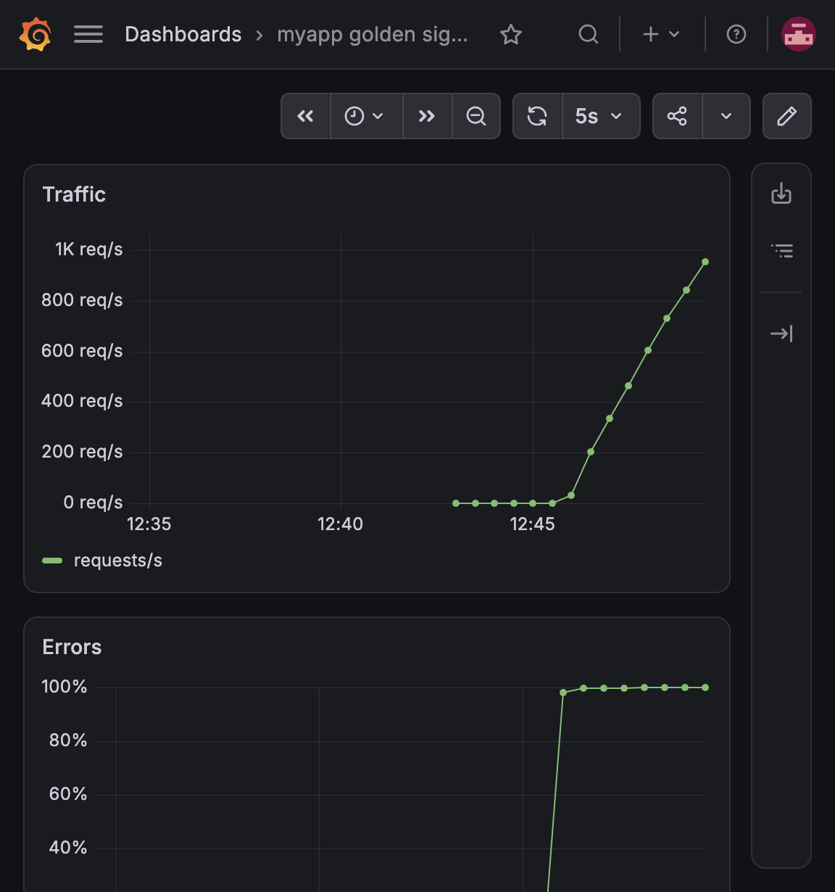

# Postmortem - HighErrorRate en dev (24 novembre 2026)

Postmortem sans blame : on decrit ce que le systeme a laisse passer, pas qui a fait quoi.

## Resume

Une image qui repond 500 sur toutes les routes sauf `/health` et `/metrics` a ete deployee dans le namespace `dev`. Les probes sont restees vertes, donc Kubernetes a considere les pods sains et ne les a pas redemarres. L'alerte `HighErrorRate` est passee en FIRING, le service a ete rollback sur l'image precedente et le ratio de 5xx est retombe a 0.

| | |
|---|---|
| Environnement | `dev` (cluster kind) |
| Image fautive | `bad-error-rate` |
| Image de retour | `ghcr.io/ruban-adhesif/devops-project:2cb63a64f11ad52196cb8f6aec891baf943199c1` |
| Impact | ~99 % des requetes hors `/health` et `/metrics` en 500 |
| Duree de l'impact | ~6 min (12:44:08 -> 12:50:16 UTC) |
| Detection (alerte FIRING) | 12:48:19 UTC |
| Mitigation | `kubectl rollout undo`, 12:50:04 UTC |

## Timeline (UTC)

| Heure | Evenement |
|---|---|
| 12:43:37 | Regle `HighErrorRate` appliquee dans `monitoring` |
| 12:43:55 | Image `bad-error-rate` deployee dans `dev`. `/health` et `/metrics` restent en 200, le reste repond 500 |
| 12:44:08 | Rollout termine, 2 pods sur cette image |
| 12:45:43 | Trafic lance vers `/` et `/error` |
| 12:46:06 | Alerte en pending, ratio de 5xx ~ 99 % |
| 12:48:19 | Alerte en FIRING |
| 12:48:31 | Logs JSON : `level=error`, `status=500` sur `/` et `/error` |
| 12:50:04 | `kubectl rollout undo deployment/myapp -n dev` |
| 12:50:16 | Retour sur l'image `2cb63a64...`, trafic arrete |
| 12:52:50 | Ratio de 5xx retombe a 0 |
| 12:53:20 | Alerte repassee inactive |

## Preuves

Alerte `HighErrorRate` en FIRING :

Dashboard pendant l'incident : le trafic monte vers ~1000 req/s a 12:45 UTC, Errors a 100 % :

## Cause

Une image avec un taux d'erreur eleve est arrivee en `dev` sans smoke test. Elle repondait 200 sur `/health` et `/metrics` et 500 partout ailleurs. Les readiness et liveness probes ne regardent que `/health`, elles sont donc restees vertes : le rollout s'est termine normalement et aucun pod n'a redemarre. Rien dans le pipeline ne verifiait que l'app repondait correctement sur ses vraies routes.

## Detection

- L'alerte a detecte le probleme : pending 23 s apres le debut du trafic, FIRING ~2 min plus tard, comme prevu avec `for: 2m`.
- Les logs JSON ont confirme tout de suite le symptome (`status=500` sur `/` et `/error`).
- Sans trafic, le ratio ne bouge pas : entre 12:44:08 et 12:45:43 les pods etaient casses mais personne ne le voyait.

## Mitigation

Rollback d'abord, comme dans le [runbook](runbook.md). Le rollback a pris ~12 s (12:50:04 -> 12:50:16). Le ratio a mis ~2 min 30 de plus a retomber a 0 parce que la requete fait un `rate` sur une fenetre de 2 minutes, puis l'alerte est repassee inactive 30 s apres.

## Ce qui a bien marche

- L'alerte s'est declenchee et le lien vers le runbook etait dans l'annotation.
- Le rollback a rendu le service en quelques secondes, sans chercher la cause d'abord.
- Les logs JSON et le dashboard ont permis de confirmer le diagnostic rapidement.

## Ce qui a mal marche

- Les probes sur `/health` ne disent pas si l'app sert correctement ses vraies routes.
- Rien ne bloquait l'image avant qu'elle soit sur tous les pods.
- ~6 min d'impact au total alors que le rollback lui-meme prend 12 s.

## Actions

| Action | Type | Effet attendu |
|---|---|---|
| Smoke test apres le deploiement : `/` et `/health` doivent repondre 200, sinon le job est rouge | Prevention | L'image est bloquee avant le trafic reel |
| Canary : un seul pod d'abord, on regarde le ratio de 5xx, puis on deploie le reste | Prevention | Moins d'impact si une mauvaise image passe |
| Garder le rollback en premiere etape du runbook | Mitigation | Temps de retour a la normale court |
