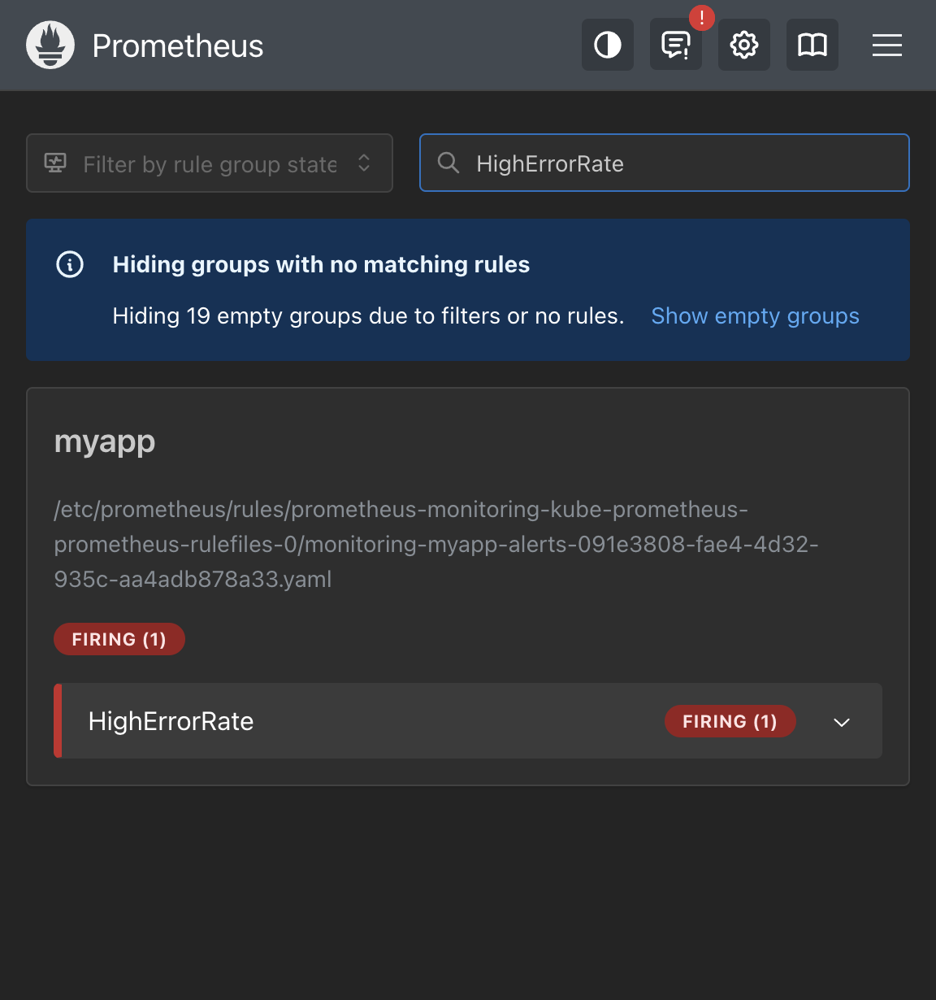

# Postmortem: taux de 5xx a ~99 % en dev apres le deploiement de l'image bad-error-rate

Postmortem sans blame : on decrit ce que le systeme a laisse passer, pas qui a fait quoi.

## Summary and impact

Le 24 novembre 2026, une image qui repond 500 sur toutes les routes sauf `/health` et `/metrics` a ete deployee dans le namespace `dev`. Les probes sont restees vertes, donc Kubernetes a considere les pods sains et ne les a pas redemarres. L'alerte `HighErrorRate` est passee en FIRING, le deployment a ete rollback sur l'image precedente et le ratio de 5xx est retombe a 0.

| | |
|---|---|
| Environnement | `dev` (cluster kind), 2 pods |
| Image fautive | `bad-error-rate` |
| Image de retour | `ghcr.io/ruban-adhesif/devops-project:2cb63a64f11ad52196cb8f6aec891baf943199c1` |
| Impact | ~99 % des requetes hors `/health` et `/metrics` en 500 |
| Duree de l'impact | ~6 min (12:44:08 -> 12:50:16 UTC) |
| Detection (alerte FIRING) | 12:48:19 UTC |
| Mitigation | `kubectl rollout undo`, 12:50:04 UTC |

## Timeline (UTC)

| Heure | Evenement |
|---|---|
| 12:43:37 | Regle `HighErrorRate` appliquee dans `monitoring` |
| 12:43:55 | Image `bad-error-rate` deployee dans `dev`. `/health` et `/metrics` restent en 200, le reste repond 500 |
| 12:44:08 | Rollout termine, 2 pods sur cette image |
| 12:45:43 | Trafic lance vers `/` et `/error` |
| 12:46:06 | Alerte en pending, ratio de 5xx ~ 99 % |
| 12:48:19 | Alerte en FIRING |
| 12:48:31 | Logs JSON : `level=error`, `status=500` sur `/` et `/error` |
| 12:50:04 | `kubectl rollout undo deployment/myapp -n dev` |
| 12:50:16 | Retour sur l'image `2cb63a64...`, trafic arrete |
| 12:52:50 | Ratio de 5xx retombe a 0 |
| 12:53:20 | Alerte repassee inactive |

Alerte `HighErrorRate` en FIRING :

Dashboard pendant l'incident : le trafic monte vers ~1000 req/s a 12:45 UTC, Errors a 100 % :

## Root cause and contributing factors

**Cause racine :** une image avec un taux d'erreur eleve est arrivee en `dev` sans smoke test. Elle repondait 200 sur `/health` et `/metrics` et 500 partout ailleurs.

**Facteurs contributifs :**

- Les readiness et liveness probes ne regardent que `/health`. Elles sont restees vertes, le rollout s'est termine normalement et aucun pod n'a redemarre.
- Rien dans le pipeline ne verifie que l'app repond correctement sur ses vraies routes apres un deploiement.
- Les 2 pods sont passes sur la nouvelle image en meme temps : pas de canary pour limiter l'impact.
- Sans trafic, le ratio ne bouge pas : entre 12:44:08 et 12:45:43 les pods etaient casses mais rien ne le montrait.
- Apres le rollback, le ratio a mis ~2 min 30 a retomber a 0 parce que la requete fait un `rate` sur une fenetre de 2 minutes.

## What went well / what went poorly

**Ce qui a bien marche :**

- L'alerte s'est declenchee comme prevu : pending 23 s apres le debut du trafic, FIRING ~2 min plus tard avec `for: 2m`.
- Le lien vers le [runbook](runbook.md) etait dans l'annotation de l'alerte.
- Rollback d'abord, cause ensuite : le service est revenu en ~12 s (12:50:04 -> 12:50:16).
- Les logs JSON (`status=500` sur `/` et `/error`) et le dashboard ont confirme le diagnostic rapidement.

**Ce qui a mal marche :**

- Les probes sur `/health` ne disent pas si l'app sert correctement ses vraies routes.
- Rien ne bloquait l'image avant qu'elle soit sur tous les pods.
- ~6 min d'impact au total alors que le rollback lui-meme prend 12 s.

## Action items (owner, deadline)

| Action | Owner | Deadline |
|---|---|---|
| Smoke test apres le deploiement : `/` et `/health` doivent repondre 200, sinon le job est rouge | Equipe pipeline CI/CD | 2026-12-01 |
| Canary : un seul pod d'abord, on regarde le ratio de 5xx, puis on deploie le reste | Equipe plateforme Kubernetes | 2026-12-08 |
| Requete synthetique continue sur `/` (blackbox exporter) pour voir les 5xx meme sans trafic utilisateur | Equipe observabilite | 2026-12-15 |
